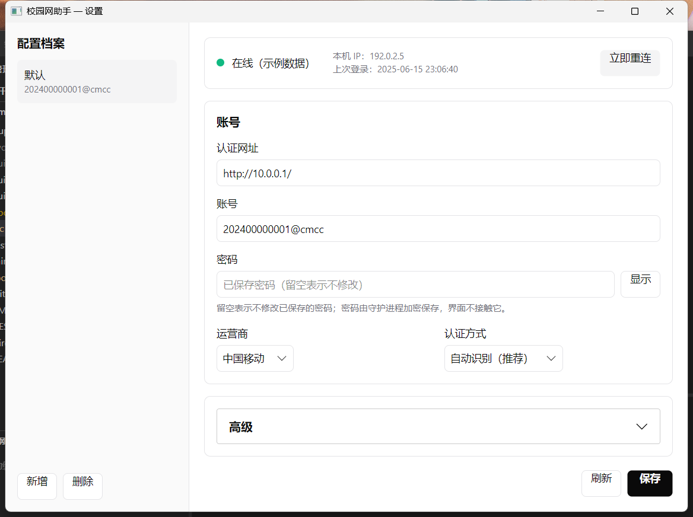
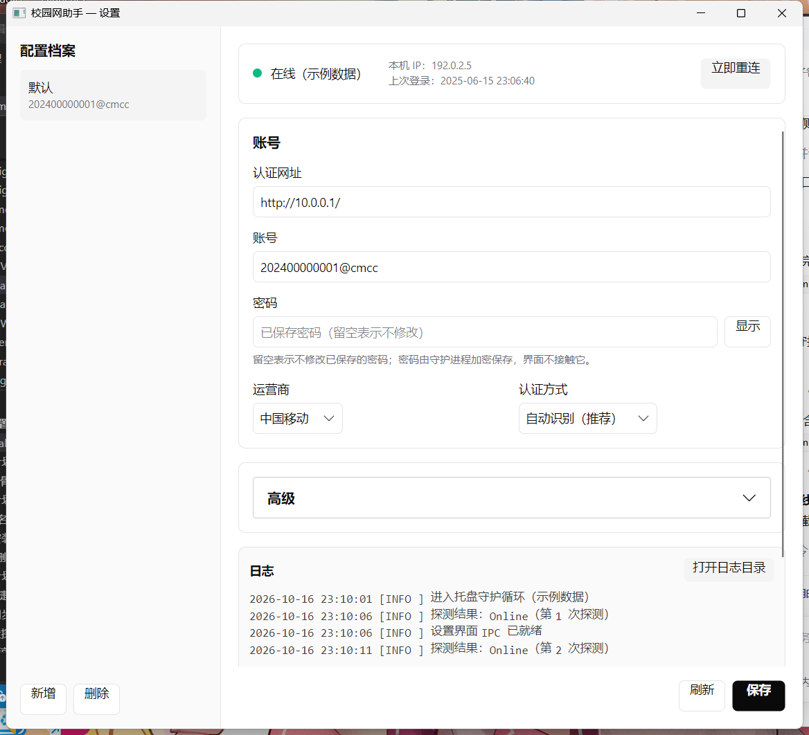

# CampusNet-Keeper

校园网自动重连守护程序。会话失效时自动重新登录，让你在游戏里感觉不到掉线。

> 当前为 **M2** 阶段：命令行守护 + 托盘常驻 + Avalonia 设置界面均已可用；交付形态是
> **单个 exe**（守护与界面是同一个文件，界面按需释放到本机缓存）。

## 特性

- **原生实现**：C++17，静态链接运行库（/MT），零动态库依赖
- **托盘即应用图标**：托盘/任务栏显示的是应用自己的图标（不再是 Windows 通用图标），
  右下角按状态合成小徽标（在线绿 / 探测蓝 / 失败红 / 断开灰）
- **双击就开界面**：双击 exe 会启动守护并**自动打开设置界面**（不再出现"点了没反应"）；
  开机自启带 `--autostart`，静默驻留不打扰
- **不留终端窗口**：exe 是 **GUI 子系统**程序（PE 子系统 = 2），本身不申请控制台——
  双击/开机自启时不会有一闪而过的黑窗，也不留下任何终端窗口；自启项指向的就是
  `CampusNet-Keeper.exe` 自己（不是 wscript 之类的启动器），在火绒/任务管理器的
  启动项列表里能直接看到、能直接管理。
  从 cmd/pwsh 运行时会自动 `AttachConsole` 接上父控制台：照常看输出、照常用 Ctrl+C
- **开机自启**：配置里开启（默认开）时，守护进程把 `"<exe>" --autostart` 写进
  `HKCU\Software\Microsoft\Windows\CurrentVersion\Run`；登录后静默拉起、不弹设置界面。
  设置界面里改「开机自启」**保存即生效**（立即同步注册表，无需重启守护）
- **极低占用**：后台常驻工作集约 15 MB（进程私有约 2.7 MB，其余为共享的 DLL 页；spec 的
  S2 目标「<10 MB」按任务管理器的"内存"列/专用工作集口径达成），空闲 CPU ≈ 0%（500ms 定时器驱动）
- **自动重连**：网络断开或被 Portal 劫持时自动重新登录（Dr.COM 完整实现）
- **会分辨"重试也没用"的失败**：服务器回「终端IP已在线」时先复测，若其实上不了网（僵尸会话）
  或账号被别处占着，就先发**注销**再重登；注销连续无效则停下并提示去门户手动处理，
  不做"每 5 秒重连一次却永远上不去"的空转
- **厂商识别**：自动识别 Portal 类型（Dr.COM / 锐捷 / 深澜 / 华为，其余回退通用表单/自定义模板）
- **密码加密**：Windows DPAPI（绑定「本机 + 当前 Windows 账号」）。密文单独存在
  `%LOCALAPPDATA%\CampusNet-Keeper\secret.json`，**不随配置漫游**；配置被拷到别的机器也解不开，
  但也不会被那边的一次保存抹掉（解不开就原样保留）。跨机迁移走「导出/导入密码」（口令加密）
- **网络感知**：监听系统地址变更（`NotifyAddrChange`），切网/睡眠唤醒后立即探测
- **单 exe 双形态**：界面程序集内嵌在 exe 里（存储型 ZIP 载荷，**不引第三方解压库**），
  首次打开设置时释放到 `%LOCALAPPDATA%\CampusNet-Keeper\ui` 并按需加载 .NET 运行时；
  载荷带版本戳，升级后自动重新释放。守护进程自身不依赖 .NET

## 快速开始

    CampusNet-Keeper.exe                              # 双击/无参数：守护 + 自动打开设置界面
    CampusNet-Keeper.exe --autostart                  # 开机自启用：守护静默驻留，不弹界面
    CampusNet-Keeper.exe --detect                     # 识别你学校的认证系统
    CampusNet-Keeper.exe --probe-now                  # 检查当前网络状态
    CampusNet-Keeper.exe --set-password --user=学号   # 录入密码（DPAPI 加密保存）
    CampusNet-Keeper.exe --export-secret=D://s.json   # 导出密码（口令加密，可拷到别的电脑）
    CampusNet-Keeper.exe --import-secret=D://s.json   # 在新电脑上导入密码
    CampusNet-Keeper.exe --test-login                 # 试一次登录（需先在门户注销）

完整步骤与反馈要求见 `docs/M1-实测指南.md`。

## 设置界面

托盘图标上**单击或双击**即可打开（等价于 `CampusNet-Keeper.exe --ui`）；界面通过命名管道
IPC 与守护进程通信，**密码明文从不离开守护进程**（界面只见「已保存密码」）。





> 上面两张是**对着探针服务端的合成示例数据**截的（模拟账号 `202400000001@cmcc`、TEST-NET 地址），
> 仓库里不放任何真实学号/门户地址的截图。

- 顶部状态条：状态灯、本机 IP、上次登录时间、立即重连
- 左侧档案栏：多账号/多学校配置切换；中部表单：认证网址、账号、密码、运营商、认证方式
- 底部日志面板：跟随守护进程日志（2 秒轮询 `get_log_tail`）；「测试登录」会**真的尝试登录一次**
- 深浅主题跟随系统，配色与组件规格来自 `DESIGN.md`（shadcn/ui），静态检查见 `tools/check_ui_tokens.ps1`

## 命令行选项

| 选项 | 说明 |
|---|---|
| （无选项） | 启动守护并**自动打开设置界面**（双击 exe 就是这个行为） |
| `--autostart` | 开机自启形态：守护静默驻留、**不**弹界面（自启动项里会自动带上） |
| `--ui` | 只打开设置界面（托盘「设置…」就是启动自身副本并带上这个参数） |
| `--ui-info` | 自检界面载荷与 .NET 运行时可用性（不弹窗；退出码 0=就绪 3=精简版 4=缺运行时） |
| `--probe-now` | 执行一次网络探测并输出结果 |
| `--test-login` | 一次探测 + 登录尝试，输出完整请求（已脱敏） |
| `--detect` | 厂商识别与运营商列表 |
| `--set-password` | 录入密码（配 `--user=账号` 指定目标；支持环境变量 `CNK_PASSWORD`） |
| `--logout` | 主动注销服务器侧会话（清僵尸会话/账号占位；配 `--user=账号`；
  注销端点按门户页下发的路径试，两个候选都记日志） |
| `--export-secret=<文件>` | 把当前档案的密码导出成**口令加密**的可携带文件（配 `--user=账号`；
  口令取环境变量 `CNK_PASSPHRASE` 或交互输入，导出时会要求输入两遍） |
| `--import-secret=<文件>` | 从导出文件恢复密码到本机密码库（口令错/文件被改会明确失败） |
| `--config=<路径>` | 使用指定的配置文件（该形态下密码密文内联在配置里） |
| `--simulate=<厂商>` | 使用本地模拟 Portal 服务器（开发/测试用） |
| `--version` / `--help` | 版本 / 用法 |

配置文件位于 `%APPDATA%\CampusNet-Keeper\config.json`（可随漫游带走，不含本机密码密文）；
密码库位于 `%LOCALAPPDATA%\CampusNet-Keeper\secret.json`（本机专属，随 DPAPI 绑定本账号）；
日志位于 `%APPDATA%\CampusNet-Keeper\logs\keeper.log`。

> 换了电脑/换了 Windows 账号时，密码解不开是**预期行为**：界面会显示「密码来自其他电脑/账号，
> 需在本机重新输入」，旧密文原样保留、不会被覆盖。想把密码带过去，用 `--export-secret` 导出、
> 在新机器 `--import-secret` 导入（或设置界面里的「密码迁移」面板）。

## 支持的认证策略

| 厂商 | 策略 | 实测状态 |
|---|---|---|
| Dr.COM 哆点（`:801` 新式 API + AES 参数） | `DrcomAuth` | **真机实测通过**（2026-10-16，见 `docs/evidence/newapi_login_20261016.md`） |
| 锐捷 eportal（`/eportal/?c=Portal&a=login` + JSONP） | `EportalAuth` | **未实测**（本机环境为 Dr.COM，无锐捷校园网） |
| 深澜 srun（`get_challenge` → `srun_portal`，HMAC-MD5 + xEncode） | `SrunAuth` | **未实测**（同上） |
| 未知厂商 / 改版门户（解析页面第一个表单） | `GenericFormAuth` | 未实测（兜底策略） |
| 任意学校（自定义模板） | `CustomTemplateAuth` | 已在模拟环境验证 |

## 自定义模板（任意学校）

学校不在上面四条策略里时，用自定义模板描述它的登录请求即可。配置写在
`%APPDATA%\CampusNet-Keeper\config.json` 的档案（`profiles[]`）里：

```json
{
  "name": "我的学校",
  "auth_url": "http://10.0.0.1/",
  "username": "学号",
  "vendor": "custom",
  "isp": { "preset": "custom", "custom": "" },
  "custom_template": {
    "method": "POST",
    "url": "http://10.0.0.1/login",
    "body": "user={username}&pass={password}&ip={ip}",
    "headers": { "Content-Type": "application/x-www-form-urlencoded" },
    "success_regex": "登录成功|注销"
  }
}
```

可用占位符（`core/Template.h`）：`{username}` `{password}` `{isp}`（运营商后缀，如 `@cmcc`）
`{ip}`（本机 IP）`{timestamp}`（Unix 秒）。**占位符替换不做 URL/表单编码**——需要编码时请在
模板里自行拼装（与门户 JS 的编码口径保持一致）。识别不到占位符时该段原样保留，便于发现拼写错误。

`success_regex` 是"登录成功"的判据（对响应正文做正则匹配）；填错会导致反复重试或误判成功，
建议先用 `--test-login` 看一次真实响应（输出已脱敏）再定。

## 已知限制

1. **锐捷 / 深澜 / 通用表单三条策略尚未在真实校园网验证**——本机所在学校是 Dr.COM。
   它们的正确性目前依据：单元测试 + 本地模拟服务器端到端（`--simulate=<厂商>`）。
   若你在锐捷/深澜学校使用，`--test-login` 的完整输出就是唯一的现场判据，请把输出贴回。
   自测方法：`CampusNet-Keeper.exe --simulate=eportal --test-login`（把 `eportal` 换成
   `srun` / `generic` / `drcom` 可分别验证四条链路）。
2. **深澜的加密细节无官方文档**：实现依据是**三份独立来源**交叉核对（深大 srun 逆向的
   门户 `Portal.js` 原文 + 可运行 Python 脚本、Rust 客户端 `srunc`、Rust 客户端
   `bitgateway-client`）——包括 `chksum = SHA1(chkstr)`（**不是** HMAC-MD5）、
   `password = {MD5} + HMAC-MD5(密码, challenge)`、`info = {SRBX1} + 换表base64(xEncode(...))`、
   `n=200/type=1/double_stack=0`、base64 带标准 padding。xEncode 的可复算脚本见
   `tools/srun_xencode_oracle.js`（两份独立实现 150 组输入零差异），`chksum` 另有
   **请求级 KAT**（在测试里独立复算，不与产品共享公式）。
   已知变体：`srunc` 走「明文 `md5(密码)` + `double_stack=1`」，本实现按前两份来源；
   若现场反馈「参数看着对但不认账号」，先试这两个开关。
   **非 ASCII 密码**存在实现口径差异：本客户端按 UTF-8 字节打包（与 srunc/Python 一致），
   门户自己的 JS 用 `charCodeAt`（UTF-16 码元）；纯 ASCII 密码两者完全一致。
3. **配置里的探测地址**：默认 `http://captive.apple.com/hotspot-detect.html`。若你的学校
   未放行该地址，改为你校 `visit_blacklist` 里的任意地址（换地址后 `--probe-now` 应回 Online）。
4. **不要求管理员权限**：因此无法复位网卡/续租 DHCP——链路本身卡死时（连门户页都打不开）
   仍需人工处理（重插网线 / 禁用启用网卡）。
5. **设置界面需要 .NET 10 运行时**（Runtime 或 Desktop Runtime 均可；守护与命令行**不需要**）：
   完整版单 exe 内嵌的是"框架依赖"的界面产物。未装运行时时点「设置」会弹窗说明并给出下载地址，
   守护照常工作。想彻底零依赖可把运行时一并打进载荷：
   `pwsh -File build.ps1 -SingleExe -SelfContainedPayload`
   （exe 会大很多，且首次需联网 restore 运行时包；本机未实测这条路径）。
6. **界面已打开但被别的窗口盖住/最小化时，再点托盘只弹一句气泡**，不会把已有窗口带到前台
   （第二个 `--ui` 会直接退出，避免连点堆出一串窗口）。想前置窗口请从任务栏切换。
7. **守护进程"没在跑"怎么查**：看 `%APPDATA%\CampusNet-Keeper\logs\keeper.log` 里**本次启动的第一段**：
   - `上次运行正常退出（来源=…，于 …）` —— 上次是体面退出的，看看是谁退的
     （托盘菜单「退出」／外部 WM_CLOSE／系统会话结束：注销或关机／控制台事件：Ctrl+C…）；
   - `上次运行没有留下正常退出记录：可能在退出前被强制结束、异常终止或掉电` ——
     上次**不是**正常退出（被任务管理器结束、崩溃、掉电），日志里不会有痕迹，只能从这条推断；
   - 退出那一行本身是 `守护循环退出，来源=…`。
   出现 `未记录（退出路径未识别）` 说明有退出路径没被覆盖到，属实现缺口。
8. **重启后没自动启动怎么查**：先确认自启项在不在——
   `reg query HKCU\Software\Microsoft\Windows\CurrentVersion\Run /v CampusNetKeeper`
   （应显示 `"…\CampusNet-Keeper.exe" --autostart`）；再打开**任务管理器 → 启动应用**看是否被
   禁用（禁用记录在 `…\Explorer\StartupApproved\Run`）。也可以直接再双击运行一次 exe：
   守护进程启动时会按配置重新登记自启项。注意自启项指向**当前运行的 exe 路径**，把程序挪了
   目录就重新运行一次即可。

## 数字签名

Windows 对**未签名**的下载程序会提示"未知发布者"（SmartScreen）。项目内置签名流程：

    # 本地自签名（免费；只有信任该证书的机器认，公开分发仍会被 SmartScreen 拦）
    pwsh -File build.ps1 -SingleExe -Sign
    # 用真实的 OV/EV 代码签名证书（推荐用于公开发布）
    pwsh -File build.ps1 -SingleExe -Sign -PfxPath codesign.pfx -PfxPassword <密码>

- **签名工具从哪来**：`signtool.exe` **不装在 VS 的 IDE 目录里**，它随 **Windows SDK** 分发；
  VS 2022 的「使用 C++ 的桌面开发」工作负载默认就会装 Windows SDK，所以签名工具通常已经在
  `C:\Program Files (x86)\Windows Kits\10\bin\<版本>\x64\signtool.exe`。VS/.NET SDK 还会带一个
  **ClickOnce SignTool**（老版本 32 位，同样支持 `/fd /tr /td`）：
  `C:\Program Files (x86)\Microsoft SDKs\ClickOnce\SignTool\signtool.exe`。
  `scripts/sign.ps1` 按 PATH → `WindowsSdkDir` 环境变量 → Windows Kits（取最高版本）→ ClickOnce
  的顺序自动找；万一都没有，会退回 PowerShell 自带的 `Set-AuthenticodeSignature`
  （可签名，但不支持时间戳）。
- 自签名模式会自动创建/复用证书（`Cert:\CurrentUser\My`），公钥导出到
  `build\certs\CampusNet-Keeper-codesign.cer`。想让**本机**不再警告，可把该 .cer 导入
  「当前用户 → 受信任的根证书颁发机构」（`Import-Certificate -CertStoreLocation Cert:\CurrentUser\Root`）——
  这等于信任"持有该证书私钥的人"签名的任何代码，请自行判断。
- 签名后自动复核（`Get-AuthenticodeSignature`）：自签名会显示证书链"不受信任"（预期）；
  只要签名者证书匹配即算成功。
- **GitHub Release 自动签名**：在仓库 Settings → Secrets and variables → Actions 配
  `CODESIGN_PFX_BASE64`（PFX 的 base64：`[Convert]::ToBase64String([IO.File]::ReadAllBytes('codesign.pfx'))`）
  与 `CODESIGN_PFX_PASSWORD`，release job 就会给两个发布包里的 exe 签名并复核；不配则跳过。
- **本项目 v0.1.1 起的官方发布包是用自签名证书签的**（签名者显示 `CampusNet-Keeper (self-signed)`）：
  文件属性里能看到数字签名，但**陌生机器上 SmartScreen 仍会警告**——这是自签名的本质局限，
  不是没签。信任该证书的办法：把 `build\certs\CampusNet-Keeper-codesign.cer`（仓库里没有，
  由 `-Sign` 生成）导入「受信任的根」。
- EV 证书更容易获得 SmartScreen 信誉；OV 证书需要一定下载量才逐步解除警告。

## 构建

依赖：Visual Studio 2022（含 C++ 桌面开发工作负载）。设置界面额外需要 .NET SDK 10。

一条命令搞定（配置 → 构建 → 测试 → **安装到 `build\Release`** → **校验产物**）：

    pwsh -File build.ps1              # 完整构建（精简版单 exe：不含设置界面）
    pwsh -File build.ps1 -SingleExe   # 完整版单 exe：发布界面 → 内嵌载荷（exe 约 24 MB）
    pwsh -File build.ps1 -SingleExe -Sign   # 同上，并对 exe 打数字签名（见「数字签名」）
    pwsh -File build.ps1 -Package     # 额外产出发布压缩包
    pwsh -File build.ps1 -SkipUi      # 只构建 C++（没装 .NET SDK 也能跑）
    pwsh -File scripts/package.ps1    # 正式发布：精简版 + 完整版两个包（见下）

脚本最后一步会校验 `build\Release` 的主程序含本次构建的日志标记、并与刚构建的产物比对
SHA256 —— 这一步是**故意**的：曾出现"新功能只构建在开发树、用户运行着旧二进制"导致
「检测不到守护进程 / 无法保存配置」的事故，所以把"同步安装"固化成脚本行为，不靠人记得。

`-SingleExe` 还会打开 `CNK_REQUIRE_REAL_PAYLOAD`：测试里"真实载荷"那条**缺载荷时算失败**
（而不是静默跳过），并用 `CampusNet-Keeper.exe --ui-info` 复核载荷结构/偏移/CRC 与 hostfxr ——
"构建出的形态与预期不符"不会留到用户手里。

手动构建（等价）：

    cmake -S . -B build-m1 -G "Visual Studio 17 2022" -A x64
    cmake --build build-m1 --config Release
    ./build-m1/Release/cnk_tests.exe

设置界面（首次需要联网 restore Avalonia 包）：

    $env:NUGET_PACKAGES = "$PWD\build-ui\nuget"
    dotnet build src/ui/CampusNet.UI -c Release
    dotnet build src/ui/ContractCheck -c Release

## 发布包

    pwsh -File scripts/package.ps1                 # 两个包都打（版本取自 Version.h）
    pwsh -File scripts/package.ps1 -Version v0.1.0 # 显式指定版本（CI 里传 tag）

产出到 `dist/`（同时会被 GitHub Release 上传）：

| 包 | 大小 | 说明 |
|---|---|---|
| `CampusNet-Keeper-<版本>-lite-win-x64.zip` | 约 0.5 MB | 单 exe（约 1 MB），**不含**设置界面载荷；点「设置」会提示用完整版。守护/CLI 功能完整 |
| `CampusNet-Keeper-<版本>-full-win-x64.zip` | 约 10 MB | **单 exe 双形态**（解压后 exe 约 24 MB）：内嵌设置界面载荷，首次打开界面时释放到本机缓存并加载 .NET 运行时。**仍是框架依赖**：目标机要装 .NET 10 运行时才有界面；零依赖形态（`-SelfContainedPayload`）尚未实测 |

`<版本>` 是带 `v` 的版本串（如 `v0.1.0`，取自 `Version.h`，与 tag 一致）。

两个包都会**解包自检**：对解出来的 exe 跑 `--version` 与 `--ui-info`，断言形态与名字相符
（精简版必须退 3、完整版必须退 0 且载荷"全部为存储型 + 干跑校验通过"）；版本号还会与
`Version.h` 比对，避免把 0.1.0 的代码发成 v0.2.0。

## 测试与验证

    ./build-m1/Release/cnk_tests.exe              # C++ 全量测试
    pwsh -File tools/check_ui_tokens.ps1          # UI 令牌层静态检查（不需要编译器）
    pwsh -File tools/verify_ui_host.ps1           # 单 exe 界面：释放载荷 → 弹窗 → 关窗退出 → 命中版本戳
    pwsh -File tools/verify_tray_open_ui.ps1      # 托盘「设置…」拉起 --ui（模拟守护，不碰真实网络）
    pwsh -File tools/verify_startup_ux.ps1        # 双击启动自动开界面、--autostart 静默、托盘用应用图标
    pwsh -File tools/verify_autostart.ps1         # 开机自启端到端：写/删 Run 键、模拟登录启动、界面保存即时生效
    python docs/evidence/audit_redaction.py       # 证据文件脱敏审计

四个 `verify_*.ps1` 脚本都是**真机验证**（要 GUI 与 `%LOCALAPPDATA%` 写入，不能在受限沙箱里跑），
`--simulate=drcom` 那条不会碰真实校园网；跑之前要先退出正在运行的托盘实例。
`verify_autostart.ps1` 会临时改动并恢复注册表自启项（并备份/恢复你的真实配置）。
界面宿主（载荷 + hostfxr）的细节见 `src/ui/README.md`。

> IPC 测试用的是**独立测试管道名**，所以即使你正开着托盘实例，测试也不会串到真守护上。

`build-m1\Release\cnk_ipc_probe.exe` 是**测试用探针服务端**（不随发布分发）：用
`--seconds=45` 起它，再跑 `ContractCheck`，即可验证跨语言 IPC 契约与界面命令。

## CI 与发布

**最新发布**：[v0.1.6](https://github.com/LunaRime/CampusNet-Keeper/releases/tag/v0.1.6)
（完整版单 exe + 精简版两个 zip，均已数字签名；附带公钥证书 `CampusNet-Keeper-codesign.cer`）。
历史版本：[v0.1.4](https://github.com/LunaRime/CampusNet-Keeper/releases/tag/v0.1.4)、
[v0.1.3](https://github.com/LunaRime/CampusNet-Keeper/releases/tag/v0.1.3)、
[v0.1.1](https://github.com/LunaRime/CampusNet-Keeper/releases/tag/v0.1.1)、
[v0.1.0](https://github.com/LunaRime/CampusNet-Keeper/releases/tag/v0.1.0)。

`.github/workflows/ci.yml`：

- **推送 / PR**：配置 → 构建（精简版）→ 跑测试 → 精简版形态自检（`--ui-info` 必须退 3）→
  证据脱敏审计 → UI 令牌检查与核心自检 → 上传产物（名字里写明 `lite`）。
- **打 `v*` tag**：先校验 tag 与 `Version.h` 一致，再用 `scripts/package.ps1` 构建
  **精简版 + 完整版两个包**（完整版走 `build.ps1 -SingleExe`，即"单 exe 双形态"），
  两个包都解包自检后上传到 GitHub Release。

发版流程：

    # 1) 改 src/native/core/Version.h 的版本号，提交
    # 2) 推送，再打 tag
    git push origin master:main
    git tag -a v0.1.0 -m "首个版本：Dr.COM 认证、托盘守护、自动重连、单 exe 设置界面"
    git push origin v0.1.0

**推送前必须自查**：跑一次 `python docs/evidence/audit_redaction.py`（CI 也会跑）。审计现在
**覆盖整个仓库**，文本文件查「学号样数字串 / MAC / 私有网段」，并要求**所有图片/压缩包资产登记在
白名单里**——未登记即失败。⚠ **新增截图必须逐张打开看过**（栅格图里的内容文本模式看不见；
2026-10-17 就栽过一次：真机截图里的学号/门户地址让"审计全绿"变成假绿）。

## 许可证

MIT
